# Exercise-7---Improve-banking-processor-design
# Ejercicio #7 - Mejora del diseño del procesador bancario

Problema #4 (Banca multi-identidad con procesadores), Week #9. Rediseño con herencia y polimorfismo para eliminar el código spaghetti en identidades, procesadores, operaciones y `ServicioBancario`.

## 1. Problemas del diseño original

- Las reglas estaban repartidas en `switch` por tipo de identidad y por procesador.
- `Identidad` era cuatro clases en una, con campos sin sentido para su tipo (nulls).
- `OperacionBancaria` cargaba campos que no aplican a todas las operaciones.
- Los procesadores fallan de tres formas distintas (`null`, `"REJECTED:"`, excepción) y el servicio conocía las tres.
- La conversión a centavos de Pacific vivía en el servicio.
- `ServicioBancario` tenía muchas razones para cambiar y no se podía probar sin los procesadores reales.
- Los valores (límites, comisiones, umbrales) estaban hardcodeados.

## 2. Diagrama de clases

```mermaid
classDiagram
    class TipoIdentidad {
        <<enumeration>>
        PERSONAL
        EMPRESARIAL
        MENOR
        RESIDENTE_EXTRANJERO
    }
    class TipoOperacion {
        <<enumeration>>
        DEPOSITO
        RETIRO
        TRANSFERENCIA_NACIONAL
        TRANSFERENCIA_INTERNACIONAL
        PLANILLA
    }

    class Usuario {
        -String id
        -String nombreCompleto
        -String cedula
        -List~Identidad~ identidades
        +buscarIdentidad(TipoIdentidad) Identidad
    }

    class Identidad {
        <<abstract>>
        #String numeroDocumento
        #String numeroCuenta
        #double limiteDiario
        #Set~TipoOperacion~ operacionesPermitidas
        +permite(TipoOperacion) boolean
        +getLimiteDiario() double
        +validar(OperacionBancaria, LocalDate) String
    }
    class IdentidadPersonal
    class IdentidadEmpresarial {
        -String nombreEmpresa
    }
    class IdentidadMenor {
        -String idUsuarioTutor
    }
    class IdentidadResidenteExtranjero {
        -String codigoPais
        -LocalDate vencimientoResidencia
    }

    class OperacionBancaria {
        <<abstract>>
        #double monto
        #String moneda
        #String codigoAprobacion
        +getTipo() TipoOperacion
        +montoTotal() double
        +cuentaContraLimite() boolean
    }
    class Deposito
    class Retiro
    class TransferenciaNacional {
        -String cuentaDestino
    }
    class TransferenciaInternacional {
        -String cuentaDestino
        -String bicDestino
    }
    class Planilla {
        -List~String~ cuentasPlanilla
    }

    class ProcesadorPago {
        <<interface>>
        +soporta(TipoOperacion) boolean
        +calcularComision(OperacionBancaria) double
        +procesar(Identidad, OperacionBancaria) ResultadoOperacion
    }
    class AdaptadorBancoNacional {
        -ProcesadorBancoNacional procesador
        +soporta(TipoOperacion) boolean
        +calcularComision(OperacionBancaria) double
        +procesar(Identidad, OperacionBancaria) ResultadoOperacion
    }
    class AdaptadorBancoPacifico {
        -ProcesadorBancoPacifico procesador
        -int factorCentavos
        +soporta(TipoOperacion) boolean
        +calcularComision(OperacionBancaria) double
        +procesar(Identidad, OperacionBancaria) ResultadoOperacion
    }
    class AdaptadorPasarelaSwift {
        -ProcesadorPasarelaSwift procesador
        +soporta(TipoOperacion) boolean
        +calcularComision(OperacionBancaria) double
        +procesar(Identidad, OperacionBancaria) ResultadoOperacion
    }

    class ProcesadorBancoNacional {
        <<externo>>
        +postTransaction(String, String, double, String) String
    }
    class ProcesadorBancoPacifico {
        <<externo>>
        +submit(String, String, long, String) String
        +submitPayroll(String, List~String~, long) String
    }
    class ProcesadorPasarelaSwift {
        <<externo>>
        +sendWire(String, String, String, double, String) String
    }

    class EsquemaComision {
        -double porcentaje
        -double cargoFijo
        -String monedaExenta
        +calcular(double, String) double
    }

    class ConfiguracionBancaria {
        -double umbralAprobacion
        -String monedaBase
        -Map~TipoIdentidad,String~ procesadoresPermitidos
    }

    class PoliticaProcesador {
        <<interface>>
        +seleccionar(Identidad, OperacionBancaria) ProcesadorPago
    }

    class ServicioBancario {
        +ejecutar(Usuario, TipoIdentidad, OperacionBancaria, LocalDate) ResultadoOperacion
    }
    class RastreadorUsoDiario {
        +usado(Identidad, LocalDate) double
        +registrar(Identidad, double, LocalDate)
    }
    class BitacoraAuditoria {
        +registrar(Identidad, OperacionBancaria, ResultadoOperacion)
    }
    class ResultadoOperacion {
        -boolean exitoso
        -String referencia
        -String motivoFallo
    }

    Usuario "1" *-- "1..*" Identidad
    Identidad <|-- IdentidadPersonal
    Identidad <|-- IdentidadEmpresarial
    Identidad <|-- IdentidadMenor
    Identidad <|-- IdentidadResidenteExtranjero
    Identidad ..> TipoIdentidad
    IdentidadEmpresarial ..> ConfiguracionBancaria

    OperacionBancaria <|-- Deposito
    OperacionBancaria <|-- Retiro
    OperacionBancaria <|-- TransferenciaNacional
    OperacionBancaria <|-- TransferenciaInternacional
    OperacionBancaria <|-- Planilla
    OperacionBancaria ..> TipoOperacion

    ProcesadorPago <|.. AdaptadorBancoNacional
    ProcesadorPago <|.. AdaptadorBancoPacifico
    ProcesadorPago <|.. AdaptadorPasarelaSwift
    ProcesadorPago o-- EsquemaComision
    AdaptadorBancoNacional --> ProcesadorBancoNacional : procesar() delega a postTransaction()
    AdaptadorBancoPacifico --> ProcesadorBancoPacifico : procesar() delega a submit() o submitPayroll()
    AdaptadorPasarelaSwift --> ProcesadorPasarelaSwift : procesar() delega a sendWire()

    PoliticaProcesador ..> ConfiguracionBancaria

    ServicioBancario o-- ProcesadorPago
    ServicioBancario o-- PoliticaProcesador
    ServicioBancario *-- RastreadorUsoDiario
    ServicioBancario *-- BitacoraAuditoria
    ServicioBancario ..> ResultadoOperacion
```

Las clases `<<externo>>` pertenecen a entidades bancarias separadas y **no se modifican**. Cada adaptador las envuelve y expone los métodos unificados de `ProcesadorPago`.



## 3. Explicación de la solución

### Identidad (herencia y polimorfismo)
`Identidad` es abstracta y define `permite`, `getLimiteDiario` y `validar`. Cada subclase aporta sus reglas:

| Subclase | Operaciones permitidas | Límite diario | Regla extra en `validar` |
|---|---|---|---
| `IdentidadPersonal` | Depósito, retiro, transferencia nacional | 2,000 | Ninguna |
| `IdentidadEmpresarial` | Todas | 50,000 | Montos mayores a 10,000 requieren código de aprobación |
| `IdentidadMenor` | Depósito, retiro | 100 | Debe tener tutor |
| `IdentidadResidenteExtranjero` | Todas excepto planilla | 5,000 | Se bloquea si la residencia venció |

Los campos propios (`nombreEmpresa`, `idUsuarioTutor`, `codigoPais`, `vencimientoResidencia`) viven solo en la subclase que los usa, así que ya no hay nulls sin sentido. Un `Usuario` tiene su propia `cedula` y puede tener varias identidades.

### Operaciones (herencia)
`OperacionBancaria` es abstracta y cada tipo es una subclase:
- `Planilla` es dueña de su lista de cuentas y calcula `montoTotal()` como monto × cantidad de empleados.
- `TransferenciaInternacional` es la única con `bicDestino`.
- `Deposito` devuelve `false` en `cuentaContraLimite()`, porque los depósitos no cuentan contra el límite diario.

### Procesadores (polimorfismo con Adapter)
Los tres procesadores son código externo, de entidades bancarias separadas, y no se pueden modificar. Cada uno tiene métodos distintos (`postTransaction`, `submit`/`submitPayroll`, `sendWire`). Para acceder a todos de forma unificada, cada uno se envuelve en un adaptador que implementa la interfaz `ProcesadorPago`. El adaptador:
- Traduce `procesar(...)` al método propio del procesador externo.
- Hace la conversión de unidades (Pacific usa centavos, por eso `factorCentavos`).
- Convierte su estilo de fallo en un `ResultadoOperacion` uniforme: `null` (Nacional), `"REJECTED:<motivo>"` (Pacific) o excepción (Swift).
- Calcula su comisión mediante un `EsquemaComision`.

### Regla "menores solo Banco Nacional"
Vive en una política separada (`PoliticaProcesador`). Si estuviera en la identidad, `IdentidadMenor` tendría que conocer a los procesadores. Si estuviera en el procesador, el adaptador tendría que conocer a las identidades. Es una regla de enrutamiento, así que queda en un único lugar con una única razón para cambiar.

### ServicioBancario
Queda como un coordinador corto. Su secuencia es:
1. Buscar la identidad del usuario.
2. Preguntar `permite(...)` y `validar(...)`.
3. Revisar el límite diario con `RastreadorUsoDiario`.
4. Pedir el procesador a `PoliticaProcesador`.
5. Llamar `procesar(...)`.
6. Registrar en `BitacoraAuditoria`.

No tiene `switch` ni conoce los estilos de fallo de los procesadores. Al recibir sus colaboradores por constructor, se puede probar con procesadores falsos.

## 4. Ejemplo de polimorfismo en código

Solo se muestran las líneas donde actúa el polimorfismo. `ServicioBancario` nunca pregunta el tipo concreto:

```java
// Identidad: cada subclase responde con sus propias reglas
Identidad identidad = usuario.buscarIdentidad(tipo);
boolean permitida = identidad.permite(operacion.getTipo());
String error = identidad.validar(operacion, hoy);

// Operación: Planilla sobrescribe montoTotal() (monto x empleados)
double total = operacion.montoTotal();

// Procesador: la política devuelve el que corresponde, el servicio solo ve la interfaz
ProcesadorPago procesador = politica.seleccionar(identidad, operacion);
double comision = procesador.calcularComision(operacion);
ResultadoOperacion resultado = procesador.procesar(identidad, operacion);
```

Cada adaptador implementa `procesar(...)` envolviendo el método distinto de su procesador externo, sin modificarlo:

```java
// AdaptadorBancoNacional
String referencia = procesador.postTransaction(cuentaOrigen, cuentaDestino, monto, moneda);
// null significa rechazo

// AdaptadorBancoPacifico
long centavos = Math.round(operacion.montoTotal() * factorCentavos);
String respuesta = procesador.submit(cuentaOrigen, cuentaDestino, centavos, moneda);
// "REJECTED:<motivo>" significa rechazo

// AdaptadorPasarelaSwift
String respuesta = procesador.sendWire(cuentaOrigen, cuentaDestino, bic, monto, moneda);
// lanza excepción si los datos son inválidos
```

Los tres devuelven un `ResultadoOperacion` uniforme, así que agregar un procesador nuevo (por ejemplo Crypto) no cambia `ServicioBancario`.

## 5. Normalización de valores hardcodeados

Ningún valor del enunciado queda escondido dentro de un método. Todos son datos:

| Dato | Dónde vive |
|---|---|
| Límites diarios (2,000 / 50,000 / 100 / 5,000) | Atributo `limiteDiario` de cada identidad (se pasa al constructor) |
| Operaciones permitidas por identidad | Atributo `operacionesPermitidas` |
| Comisiones (Nacional 0; Pacific 0.5%; Swift 25 fijo + 1%, exenta en USD) | `EsquemaComision` de cada adaptador |
| Umbral de aprobación (10,000) y moneda base (USD) | `ConfiguracionBancaria` |
| Procesadores permitidos por identidad (menor: solo Banco Nacional) | `ConfiguracionBancaria` |
| Factor de centavos (100) | `factorCentavos` en `AdaptadorBancoPacifico` |

## 6. Respuestas a las preguntas guía

1. **Reglas de la identidad:** operaciones permitidas, límite diario y verificaciones extra (tutor, residencia, aprobación). `Identidad` abstracta, y cada subclase sobrescribe `validar` y aporta sus datos.
2. **Contrato común de procesadores:** la interfaz `ProcesadorPago` con un adaptador por procesador. Los procesadores externos no se modifican.
3. **Dónde vive "menores solo Banco Nacional":** en una política separada, porque es una regla de enrutamiento que no pertenece ni a la identidad ni al procesador.
4. **Jerarquía de operaciones:** sí. Cada operación tiene solo los campos que le corresponden (planilla con su lista, depósito sin BIC).
5. **Conteo de cambios:**

| Cambio | Diseño original | Rediseño |
|---|---|---|
| Identidad "Ciudadano de oro" (límite 3,000) | Editar 4 métodos de `ServicioBancario` + el enum | 1 clase nueva (`IdentidadCiudadanoOro`) + 1 valor en el enum |
| Procesador "Crypto" (solo internacional) | Editar 3 métodos de `ServicioBancario` + su creación con `new` | 1 clase nueva (`AdaptadorCrypto`) + registrarlo en la lista de procesadores |

En el original, `ServicioBancario` se modifica en ambos casos. En el rediseño no cambia: agregar un tipo es agregar una clase. Los cambios crecen con la cantidad de tipos nuevos, no con las combinaciones K × O × P.
